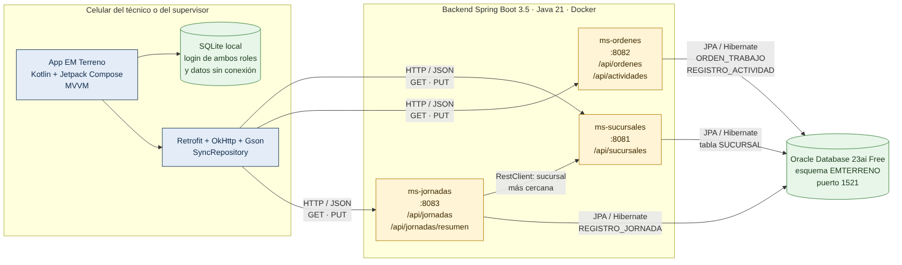
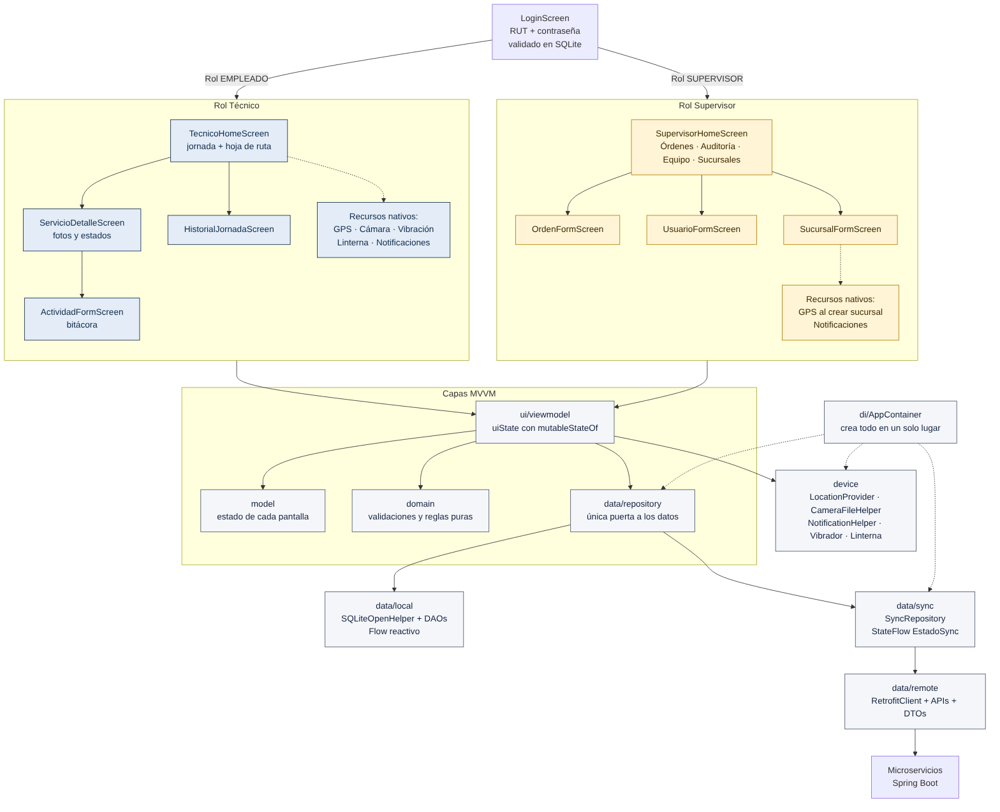
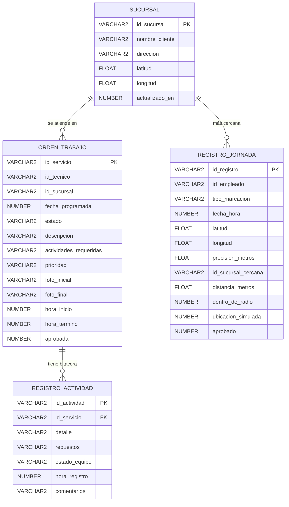
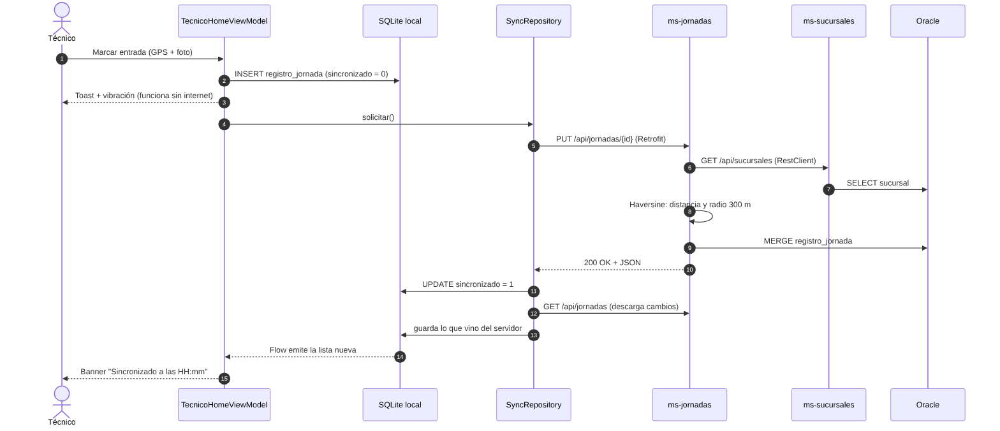

# Arquitectura EM Terreno (Experiencia 3)

Este documento va en la rama `documents` del repositorio Android, como pide la pauta. Contiene el diagrama de arquitectura de microservicios y el diagrama de arquitectura del proyecto Android, más el modelo de datos en Oracle y el flujo de sincronización.

Los diagramas están en `docs/diagramas/` en dos formatos: `.mmd` (Mermaid, se ve directo en GitHub) y `.png` (para adjuntar o mostrar en la revisión).

## 1. Arquitectura de microservicios

| Microservicio | Puerto | Responsabilidad | Endpoints |
|---|---|---|---|
| ms-sucursales | 8081 | Repositorio de sucursales de los clientes con sus coordenadas | `GET/POST /api/sucursales`, `GET/PUT/DELETE /api/sucursales/{id}` |
| ms-ordenes | 8082 | Órdenes de trabajo y bitácora de actividades | `GET/POST /api/ordenes` (filtros `tecnicoId`, `estado`), `GET/PUT/DELETE /api/ordenes/{id}`, `GET /api/ordenes/{id}/actividades`, `GET/POST /api/actividades`, `PUT /api/actividades/{id}` |
| ms-jornadas | 8083 | Marcaciones de entrada y salida con GPS y resumen de horas | `GET/POST /api/jornadas` (filtro `empleadoId`), `GET/PUT /api/jornadas/{id}`, `GET /api/jornadas/resumen?fecha=AAAA-MM-DD` |

Decisiones de diseño:

- **Un microservicio por área del negocio.** Cada uno es dueño de sus tablas y se puede desplegar y escalar por separado.
- **Comunicación entre microservicios.** ms-jornadas consulta a ms-sucursales con `RestClient` para recalcular en el servidor la sucursal más cercana y si la marcación quedó dentro del radio de 300 m. Así el dato no depende solo de lo que diga el teléfono. Si ms-sucursales no responde, se guardan los valores que envió el dispositivo.
- **Base de datos relacional Oracle.** Oracle Database 23ai Free en Docker (`gvenzl/oracle-free`), esquema `EMTERRENO`. Las tablas las crea Hibernate (JPA) al iniciar cada microservicio.
- **Autenticación local.** Como pide la pauta, el login de ambos roles se valida en SQLite dentro del teléfono (RUT + contraseña con hash SHA-256). El servidor no guarda contraseñas.
- **Errores claros.** Cada microservicio responde 400 con el error de cada campo, 404 si el recurso no existe y 409 cuando se rompe una regla de negocio (por ejemplo, devolver una orden FINALIZADA a PENDIENTE).

## 2. Arquitectura del proyecto Android

La app usa MVVM con los mismos paquetes vistos en clases (`model`, `ui/screen`, `ui/viewmodel`, `ui/components`, `ui/navigation`, `ui/theme`) y suma:

- `data/local`: SQLite con `SQLiteOpenHelper`, 5 tablas y DAOs que devuelven `Flow`.
- `data/remote`: `RetrofitClient` (Retrofit + OkHttp + Gson), una interfaz por microservicio (`SucursalApi`, `OrdenApi`, `JornadaApi`) y los DTO que viajan como JSON.
- `data/sync`: `SyncRepository`, que sube los cambios pendientes y descarga los del servidor. Expone su estado en un `StateFlow` que las pantallas muestran en un banner.
- `data/repository`: única puerta a los datos para los ViewModels.
- `domain`: validaciones y reglas de negocio en Kotlin puro, con pruebas unitarias.
- `device`: recursos nativos (GPS, cámara, notificaciones, vibración y linterna).
- `di/AppContainer`: crea la base, los repositorios, Retrofit y los recursos nativos en un solo lugar.

### Navegación y recursos nativos por rol

| Rol | Pantallas | Recursos nativos |
|---|---|---|
| Técnico (`EMPLEADO`) | Inicio (jornada + hoja de ruta), Detalle de servicio, Registro de actividad, Historial | GPS para marcar, cámara para evidencias, vibración, linterna, notificación de orden nueva |
| Supervisor | Inicio con pestañas Órdenes, Auditoría, Equipo y Sucursales; formularios de orden, usuario y sucursal | GPS para registrar la ubicación de una sucursal, notificación cuando un técnico finaliza un servicio |

Después del login, `Routes.homeFor(rol)` decide la pantalla de inicio y `navigateClearing` borra el login del historial, así el botón Atrás no vuelve a él. Cerrar sesión limpia la sesión guardada en `SharedPreferences` y vuelve al login.

## 3. Modelo de datos en Oracle

La relación ORDEN_TRABAJO → REGISTRO_ACTIVIDAD es una llave foránea real, porque las dos tablas pertenecen a ms-ordenes. Las relaciones con SUCURSAL son lógicas (se guarda el id), porque cada tabla pertenece a un microservicio distinto y en una arquitectura de microservicios una tabla no se amarra a la de otro servicio.

## 4. Flujo de sincronización

La app guarda primero en SQLite (funciona sin señal en terreno) y luego sincroniza con Retrofit:

1. Cada cambio local queda con `sincronizado = 0`.
2. `SyncRepository` envía los pendientes con `PUT` (si el servidor ya lo tiene, lo actualiza; si no, lo crea).
3. Si el servidor rechaza un cambio (400 o 409), se conserva la versión del servidor.
4. Después descarga todo con `GET` y actualiza SQLite. Los `Flow` de los DAOs avisan a los ViewModels y la pantalla se redibuja sola.
5. Si no hay conexión, el banner muestra cuántos cambios faltan por enviar y se reintenta en la siguiente sincronización.
